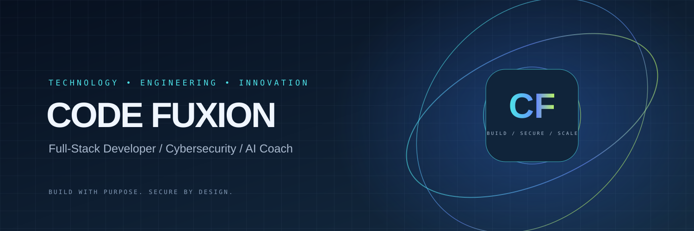

# Code Fuxion

### Full-Stack Developer · Cybersecurity Practitioner · AI Coach · Technology Entrepreneur

Building practical digital products, secure web applications, fintech experiences, and technology solutions for real-world problems.

\n

---

## About

I am a technology professional and entrepreneur interested in the intersection of software engineering, cybersecurity, artificial intelligence, and digital business.

My work focuses on turning ideas into useful digital products: planning their architecture, building web experiences, integrating services, troubleshooting deployments, and documenting systems so they can be maintained and improved.

- **Software development:** PHP, Laravel, JavaScript, Node.js, SQL, and web application development.
- **Cybersecurity:** security awareness, secure application design, infrastructure fundamentals, and defensive security learning.
- **AI & education:** AI coaching, practical technology education, and exploring AI-enabled workflows.
- **Product building:** fintech, digital marketplaces, sports technology, and community-development platforms.
- **Operations:** Linux/Termux environments, cPanel hosting, deployment troubleshooting, and application process management.

I value practical engineering, clear documentation, responsible security, and continuous learning.

## Technology toolbox

| Area | Technologies and tools |
|---|---|
| Languages | PHP, JavaScript, SQL, Python (working familiarity) |
| Backend | Laravel, Node.js, Express |
| Frontend | HTML, CSS, JavaScript, responsive UI |
| Data | Relational databases, SQL |
| Infrastructure | Linux, Termux, cPanel, Composer, npm |
| Process & delivery | Git, GitHub, PM2, Cloudflare Tunnel, ngrok |
| Integrations | Payment gateway concepts and API integrations, including Flutterwave and Paystack |

> This is a practical working toolkit, not a claim of equal depth in every technology. Individual project documentation should state the exact stack and implementation status.

## Selected product work

The following is a selection of products, ventures, and concepts I have worked on, planned, or explored. Their inclusion describes my product experience and interests; it does not imply that every project is publicly deployed or complete.

| Project | Focus | Product direction |
|---|---|---|
| **Strydo Technology** | Software and digital services | Web development, business platforms, marketing and technical solutions |
| **Strydo Pay** | Fintech | Payment experiences, merchant tools, dashboards, and gateway integration |
| **ZentraPays** | Digital finance and learning | Digital skills materials and financial-service concepts |
| **SportsFlowsAI** | Sports technology | Sports content, predictions, subscriptions, user dashboards, and administration |
| **Website Script Marketplace** | E-commerce | A marketplace concept for browsing, previewing, and purchasing website scripts |\n| **CJ Grand Group / CJ Grand Solutions** | Finance, autos and real estate | Public business website: [cjgrandgroup.com](https://cjgrandgroup.com/) |\n| **CJ Grand Exchange** | Business platform | Portfolio entry; scope and services to be confirmed and documented |
| **AgriPay Global** | Agri-finance concept | Tiered investment-product and portfolio planning |

More context and project status notes are maintained in [PROJECTS.md](PROJECTS.md).

## Engineering interests

- Building maintainable PHP and Laravel applications.
- Designing reliable APIs and integrating third-party services.
- Creating responsive dashboards and role-based administration.
- Improving authentication, authorization, input validation, and data protection.
- Debugging production issues across PHP, Node.js, databases, and hosting environments.
- Exploring practical AI applications and automation.
- Documenting architecture, installation, configuration, and operational procedures.

## Portfolio website

The repository includes a responsive static portfolio built with HTML, CSS and vanilla JavaScript. See [README-WEBSITE.md](README-WEBSITE.md) for local preview and GitHub Pages deployment instructions.

## How I approach projects

1. Understand the problem, users, and business requirements.
2. Define a realistic MVP and system architecture.
3. Build in small, testable increments.
4. Protect user data and validate security-sensitive operations.
5. Document setup, configuration, and maintenance.
6. Test, deploy, monitor, and improve based on feedback.

## Collaboration

I welcome thoughtful conversations about full-stack development, fintech integrations, cybersecurity, AI-enabled products, product architecture, MVP planning, and technical collaboration.

[Explore my repositories](https://github.com/codefuxion?tab=repositories) · [Connect on GitHub](https://github.com/codefuxion) · [Email: strydotechnologi@gmail.com](mailto:strydotechnologi@gmail.com)

---

**Build with purpose. Secure by design. Improve continuously.**

